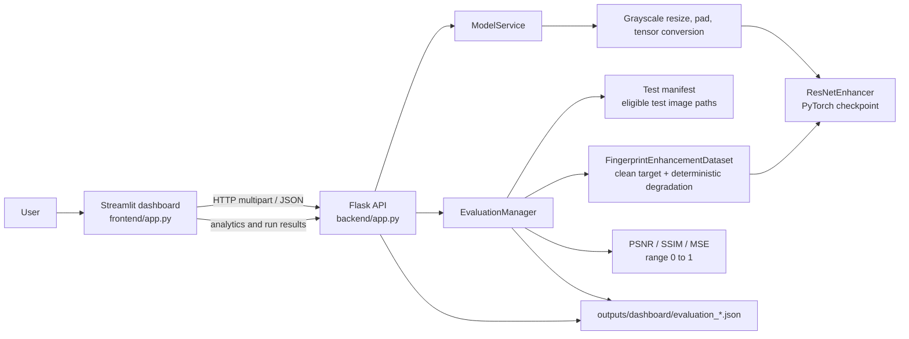

# Fingerprint Image Enhancement

This repository contains a PyTorch fingerprint image restoration project and a local research dashboard. The training pipeline learns from clean fingerprint images and synthetically degraded inputs. The dashboard provides checkpoint-based image inference, before/after inspection, and held-out manifest evaluation through separate Flask and Streamlit processes.

Model-backed features require a compatible local checkpoint. Dashboard evaluation additionally requires a test manifest whose image paths are accessible to the Flask process. The repository's configured defaults point to `outputs/checkpoints/best.pt` and `outputs/dataset_splits/test.csv`; configure alternate paths when those artifacts are absent.

## Features

- Train the existing grayscale `ResNetEnhancer` using train and validation manifests.
- Prepare dataset inventory and train/validation/test manifests from an image directory.
- Upload PNG, JPG/JPEG, TIF, or TIFF images through the dashboard and run the configured PyTorch checkpoint.
- Compare the original input and model output, inspect pixel intensity distributions, and download the enhanced PNG.
- Start evaluation explicitly against eligible rows in the held-out test manifest. Each clean manifest image is paired with a deterministic synthetic degradation generated by the dataset implementation; it is not paired with a separate degraded file.
- Calculate per-image PSNR, SSIM, and MSE against the clean target, with inference latency reported separately.
- Persist completed dashboard evaluations as JSON, view persisted run analytics, and export per-image evaluation rows as CSV.
- Use the Flask REST API independently of the Streamlit interface.

Traditional processing utilities (including CLAHE) and a separate legacy prediction script are present, but they are not fallbacks for dashboard inference. The dashboard reports model errors instead of substituting a filter.

## Technology

- Python and PyTorch: model definition, training, inference, datasets, and tensors.
- Pillow and NumPy: image decoding, grayscale preprocessing, and array operations.
- scikit-image: SSIM implementation used by dashboard evaluation.
- Flask and Flask-Cors: local inference/evaluation API and configured local CORS origins.
- Streamlit: dashboard UI; Requests: API communication; pandas and Plotly: evaluation tables and visualizations.
- OpenCV: standalone prediction and CLAHE utilities.
- pytest: automated tests (installed through `requirements-dashboard.txt` or separately).

## Architecture



## Repository layout

```text
backend/                 Flask API, model service, evaluation manager, metrics, config
frontend/                Streamlit app, API client, styles, state and visualization helpers
src/                     Model, preprocessing, datasets, training and project utilities
tests/                   Dashboard and frontend tests
outputs/checkpoints/     Local model checkpoints (not dependencies to commit)
outputs/dataset_splits/  Dataset inventory and split manifests
outputs/dashboard/       Runtime evaluation JSON and processing history
datasets/                Local fingerprint dataset files, if configured/present
requirements.txt         Project runtime dependencies
requirements-dashboard.txt Dashboard plus pytest dependency entry point
DASHBOARD_SETUP.md       Dashboard configuration and launch notes
```

Other generated outputs are created by the corresponding training, preparation, prediction, and evaluation commands. Check the CLI `--help` output before running a script with non-default options.

## Prerequisites

- Python 3.10 or newer. Python 3.11 is the version used for the current project verification environment.
- A supported PyTorch build for your operating system and desired accelerator. CPU inference is supported by the model service; CUDA is used only when available through the project's device selection.
- A compatible checkpoint for real enhancement and dashboard evaluation.
- A prepared test manifest and readable image paths for dashboard evaluation.

## Installation

Create one environment at the repository root. The frontend and backend run as separate processes but use the same Python environment and dependencies.

### Windows PowerShell

```powershell
py -3.11 -m venv .venv
.venv\Scripts\Activate.ps1
python -m pip install --upgrade pip
python -m pip install -r requirements-dashboard.txt
```

### macOS or Linux

```bash
python3 -m venv .venv
source .venv/bin/activate
python -m pip install --upgrade pip
python -m pip install -r requirements-dashboard.txt
```

The dependency file declares `torch>=2.1`. For a particular CUDA runtime or platform-specific PyTorch wheel, follow the current installation selector at [pytorch.org](https://pytorch.org/get-started/locally/) and install the selected build in the environment. Do this before installing the remaining requirements if your platform needs a custom wheel. `torch_directml` is optional and is only attempted by the device helper when installed; it is not required for CPU/CUDA use.

The dashboard dependency command includes pytest. To install runtime dependencies without test tooling, use `python -m pip install -r requirements.txt`.

## Checkpoint setup

By default the Flask service looks for `outputs/checkpoints/best.pt`. Set `FPRINT_CHECKPOINT` to another local checkpoint path before starting Flask:

```powershell
$env:FPRINT_CHECKPOINT = "D:\models\best.pt"
```

```bash
export FPRINT_CHECKPOINT=/path/to/best.pt
```

The dashboard service constructs `src.model.ResNetEnhancer` and strictly loads the checkpoint's `model_state_dict`. Optional checkpoint metadata used by the service includes `image_size`, `features`, `num_blocks`, and `epoch`; defaults are applied for image size/features/block count when omitted. A checkpoint with incompatible keys or tensor shapes is reported as unavailable. Check `/api/health` after Flask starts to inspect checkpoint existence, load state, selected device, expected input size, and any initialization error. Do not accept untrusted checkpoint files: the service loads only its configured local checkpoint.

The default CLI checkpoint path is also `outputs/checkpoints/best.pt`; training writes `best.pt` and `last.pt` under its configured checkpoint directory. Keep model files out of source control where appropriate.

## Dataset setup

Image discovery and split preparation are implemented in `src.prepare_splits`. Supply a root containing supported images (BMP, DIB, PNG, JPG/JPEG, TIF/TIFF, or WEBP):

```powershell
python -m src.prepare_splits --root "D:\data\fingerprints"
```

```bash
python -m src.prepare_splits --root /path/to/fingerprints
```

By default, manifests are written to `outputs/dataset_splits/` as `dataset_inventory.csv`, `train.csv`, `validation.csv`, and `test.csv`. The default split ratios are 0.8/0.1/0.1 with seed 42. The grouping rules are conservative heuristics: SOCOFing filename IDs are heuristic and FVC grouping by directory partition does not prove identity separation. Review the generated inventory and split metadata before making scientific claims.

Training and CLI evaluation consume the split manifests. Dashboard evaluation reads `FPRINT_TEST_MANIFEST` (default `outputs/dataset_splits/test.csv`) and uses rows marked `split=test` with an eligible candidate status. Paths are stored in the manifest and must be accessible from the Flask process. Each selected clean source image is preprocessed as the target and degraded deterministically for the model input using evaluation seed 1234; there is no separate clean/degraded filename-pair convention in this dashboard pipeline. The full test set is not run automatically at startup.

## Run the dashboard

Start Flask and Streamlit from the repository root in separate terminals with the same activated environment.

Terminal 1 — backend:

```powershell
python -m backend.app
```

Terminal 2 — frontend:

```powershell
python -m streamlit run frontend/app.py
```

The defaults are Flask at `http://127.0.0.1:5000` and Streamlit at `http://localhost:8501`. Flask host and port can be set with `FPRINT_API_HOST` and `FPRINT_API_PORT`. The UI's backend base URL is session-configurable in Settings and defaults to `http://127.0.0.1:5000`.

Check backend status at:

```text
GET http://127.0.0.1:5000/api/health
```

The API also provides `POST /api/enhance` (multipart field `image`), `GET /api/analytics`, `POST /api/evaluate`, and `GET /api/evaluate/<job_id>`. Evaluation starts asynchronously and returns a job ID. Upload size is limited by `FPRINT_MAX_UPLOAD_MB` (default 12 MB). Dashboard CORS is configured for the local Streamlit origins on port 8501.

## Dashboard workflow

1. Open the Streamlit URL printed by the command above. The Overview offers navigation to enhancement and evaluation workflows.
2. On **Enhance Image**, upload PNG/JPG/JPEG/TIF/TIFF and run enhancement. Multi-frame inputs use the first frame. The API returns an 8-bit grayscale PNG at the checkpoint's expected square dimensions.
3. Use **Image Comparison** for the original/output views and their pixel-intensity distribution. Intensity distribution is not a reference-based quality measure.
4. On **Model Evaluation**, start held-out evaluation explicitly. Select a persisted run to inspect per-image rows and export CSV.
5. Open **Analytics** to compare persisted evaluation runs and export selected rows. Analytics has no synthetic data when no evaluation runs exist.

Successful enhancement processing events and evaluation runs are persisted under `FPRINT_RESULTS_DIR` (default `outputs/dashboard`). Each evaluation receives a unique JSON filename; prior results are retained. Evaluation latency is measured around model forward inference, separately for each image; total evaluation runtime is not used as an image-quality metric.

## Evaluation metrics

Dashboard evaluation compares each model output with the corresponding clean target generated from the same manifest image. Preprocessing converts to grayscale, performs aspect-preserving resize with white padding to the checkpoint's square input size, and maps 8-bit intensity to floating point `[0, 1]`.

- **MSE** is the mean squared pixel difference.
- **PSNR** is `10 log10(1 / MSE)` in dB for the `[0,1]` range. Exact reconstruction has no finite PSNR; the dashboard stores that value as unavailable (`null`).
- **SSIM** is calculated by scikit-image with `data_range=1.0`.
- The run summary is the arithmetic mean of available finite per-image values for each metric. Per-image inference latency is recorded in milliseconds and summarized separately; it is not an image-quality metric.

These reference-based metrics must not be interpreted for an arbitrary upload without a valid corresponding clean target. The dashboard computes them only in its paired synthetic test evaluation.

## Training and command-line utilities

Training is separate from dashboard inference and is intended to run in the project's configured training environment (including Kaggle when that is the chosen GPU environment). The local dashboard does not train or tune the model. Available module entry points include:

```text
python -m src.train --help
python -m src.inference --help
python -m src.evaluate --help
python -m src.prepare_splits --help
python -m src.data_validation --help
```

Training reads the train and validation manifests, uses `FingerprintEnhancementDataset`, and writes checkpoints and training history to the configured/default output locations. Review each command's help before running; training and evaluation can write files under `outputs/`.

## Troubleshooting

- **Model unavailable / checkpoint missing:** set `FPRINT_CHECKPOINT`, verify the file exists and matches `ResNetEnhancer`, then restart Flask and inspect `/api/health`.
- **Frontend cannot reach Flask:** start the backend first, check its terminal, and verify the base URL in dashboard Settings. The defaults assume both processes run on the same machine.
- **Upload rejected:** confirm the extension is PNG, JPG/JPEG, TIF, or TIFF, the image decodes successfully, and its size is below `FPRINT_MAX_UPLOAD_MB`.
- **TIFF decoding:** the first frame of a multi-frame image is used. Corrupt or unsupported TIFF data returns a validation error.
- **Evaluation reports missing data:** set `FPRINT_TEST_MANIFEST` to a valid generated test manifest and confirm its eligible image paths are readable by Flask.
- **CPU/CUDA differences:** device selection is performed at runtime; a Kaggle GPU does not imply CUDA availability on the local machine. Use a PyTorch build compatible with the local OS and accelerator.
- **Dependency installation:** install PyTorch for the target platform using the PyTorch selector, then install the project requirements in the activated environment. If wheels are unavailable, confirm Python and platform compatibility.

## Limitations and reproducibility

- Dataset split grouping uses the documented filename/directory heuristics and does not guarantee identity-disjoint splits for all datasets.
- Evaluation's deterministic degradation is seeded with 1234 and keyed by dataset index. Results are tied to the manifest ordering, preprocessing implementation, checkpoint, and installed numeric libraries.
- Reported scores apply to the configured synthetic degradation protocol and are not a general claim about all fingerprint inputs.
- Device availability and latency depend on the local runtime and hardware.
- The repository contains local dataset/checkpoint artifacts that may be excluded from Git; paths must be configured on each machine.

## Development and tests

Install the dashboard/test dependencies with `python -m pip install -r requirements-dashboard.txt`, then run from the repository root:

```powershell
python -m pytest tests
```

The test suite includes isolated API, preprocessing, metric, persistence, and frontend helper tests; model inference is mocked in many unit tests. A real checkpoint-backed TIFF integration test runs only when the configured checkpoint and sample image are present, otherwise pytest skips it. Passing mocked tests alone does not establish that a particular checkpoint loads or that local hardware provides a desired accelerator.

## License and attribution

No repository license file was found during documentation preparation. Unless a license is added by the project owner, reuse and redistribution permissions are not specified here. Dataset terms and attribution requirements are separate and should be checked against the source of each locally configured dataset.
